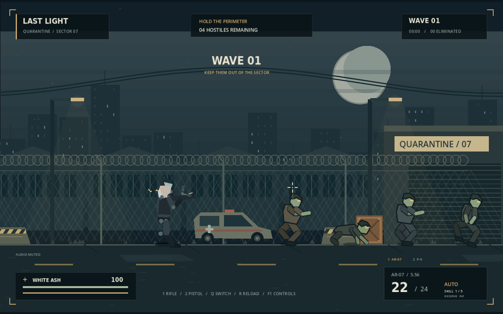
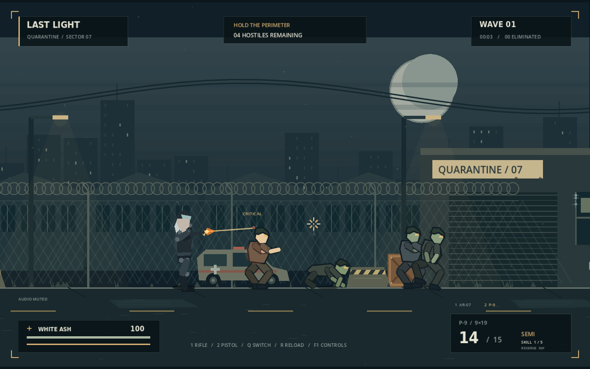
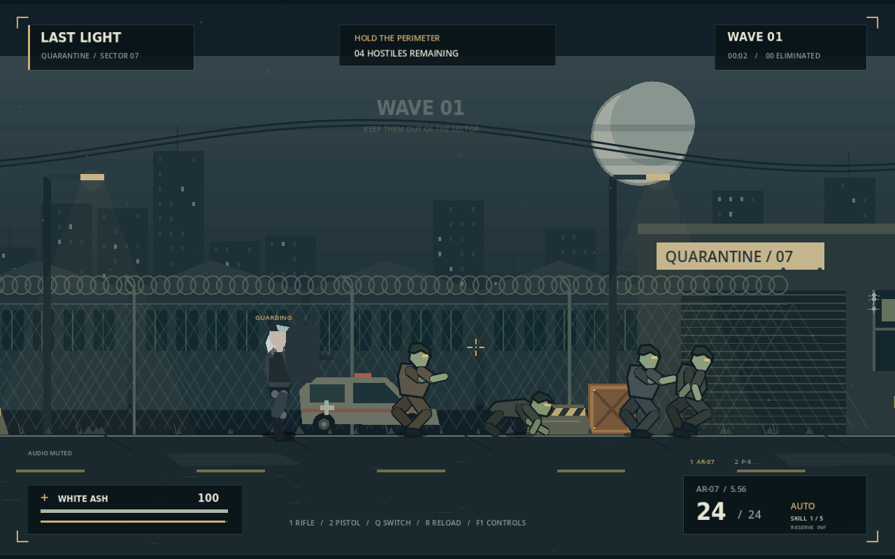

# LAST LIGHT / 最后灯火

丧尸末日题材的 2D 横版射击原型，使用 **Godot 4.6.3** 开发。无第三方插件、无联网服务、无运行时下载。建议使用相同版本的 Godot；项目采用 GL Compatibility 渲染器。

本轮重点是先稳定动画、挂点和战斗反馈。玩家使用无贴图的模块化 `Skeleton2D/Bone2D` 骨骼，身体部位都有独立名称和换肤插槽；未来替换对应贴图时，不需要重写步态、双手 IK、武器动画或射击逻辑。游戏包含移动惯性、武器熟练度、步枪与手枪、盾牌、四类僵尸和分材质命中反馈。







## 运行

使用 Godot 4 打开 `project.godot`，按 F6 或 F5 启动。Linux / macOS 也可以运行：

```sh
./run.sh
```

在纯命令行云环境，运行逻辑测试；实际操作需要有图形显示的电脑。当前云环境也可以通过虚拟显示器检查渲染。

```sh
./run.sh --headless --editor --import --quit
./run.sh --headless --script tests/combat_test.gd
./run.sh --headless --script tests/input_test.gd
```

`run.sh` 自动把 Godot 的用户数据、配置和缓存放到可写目录，无须修改系统设置。第一次打开会生成忽略的 `.godot/` 导入缓存。

## 操作

| 操作 | 按键 |
| --- | --- |
| 开始 / 死亡后重开 | Enter |
| 左右移动 | A / D，或方向键 |
| 瞄准 / 射击 | 鼠标 / 左键；步枪全自动，手枪半自动 |
| 切换武器 | 1 步枪、2 手枪，或 Q 循环切换 |
| 举盾 | 按住右键，防护正面，无法同时开枪 |
| 换弹 | R，空弹匣点击射击也会自动换弹 |
| 跳跃 / 冲刺 | Space / Shift |
| 暂停 / 帮助 | Esc / F1 |
| 静音 / 减少动态效果 | M / V |

子弹从武器骨骼上的真实 `Muzzle` 挂点发出，弹壳从 `EjectPort` 抛出。AR-07 使用 5.56 弹药、24 发弹匣和全自动射击；P-9 使用 9×19 弹药、15 发弹匣和半自动射击。两把武器分别保存弹匣余量。低熟练度持续全自动射击会累积后坐力、让实际准星上移并扩大弹着范围；命中和爆头会提高当前武器熟练度，最高 5 级。盾牌会减速并消耗体力，不能挡住背后的攻击。波次会混合生成慢行者、快行者、奔跑者和爬行者。

## 已实现的反馈

- 16 个 `Bone2D` 组成的无皮肤人形骨骼，以及 18 个以上具名换肤插槽；头、躯干、四肢、盾牌与武器可以分别换图。
- 下肢使用两段式 IK 和脚底目标，上肢使用武器前后握把目标；贴图替换后仍沿用相同动作。
- 移动加速、刹车惯性、转身阻力、奔跑身体前倾、空中控制、跳跃缓冲、落地尘土和脚步声。
- 射击抬枪前摇、射后恢复、武器切换、分层枪口火焰、枪口烟、枪口上抬、准星扩散和曳光线。
- 弹壳从抛壳口飞出，具有旋转、重力、两次地面反弹、落地声音和渐隐。
- 金属产生火星与高频撞击声，混凝土产生灰尘和碎屑，木材产生长条木屑，玻璃产生碎片和裂纹；血肉保留喷溅、硬直和爆头反馈。
- 数据驱动武器参数：射击模式、弹种、射速、弹匣、换弹、伤害、单发后坐力、持续射击惩罚和恢复速度。
- 慢行者、快行者、奔跑者和爬行者拥有不同生命、速度、攻击节奏、轮廓、步幅、身体前倾和命中区域。
- 身体 / 头部命中判定、命中标记、短暂停顿、击退、硬直、击倒、伤害边缘反馈和死亡统计。
- 举盾火花、金属反馈音、体力消耗与恢复；减少动态模式关闭震屏和命中停顿。
- 原创多层城市隔离区背景：月亮、天际线、废弃车辆、铁丝网、警戒路障、灯光和飘尘。
- 由代码合成的步枪、弹匣、脚步、命中、受伤与盾牌音效；可静音。

## 验证与限制

`tests/combat_test.gd` 直接运行真实战斗逻辑，检查骨骼和换肤插槽、武器挂点、移动惯性、动作前后摇、枪口火焰、弹壳、四种材质反馈、四类僵尸、射击节奏、后坐力、武器切换、爆头、换弹、盾牌、暂停、波次和重开。

`tests/input_test.gd` 通过 Godot 输入事件和实时物理循环，验证 Enter、移动键、跳跃、步枪连射、手枪单击、独立弹匣、武器数字键切换、举盾、换弹、暂停与恢复、帮助和减少动态模式。当前共 **79 项检查通过**，另已用真实 OpenGL 渲染并录制 300 帧战斗演示。

这是手感验证原型，玩家目前刻意使用简单骨骼占位造型，尚未套正式角色皮肤。没有游戏手柄、联机、存档、移动端适配或独立安装包。车辆、木箱、金属标牌、玻璃和混凝土块带子弹材质反馈，但仍不阻挡角色移动；围栏等其他场景物件只是背景。

## 项目结构

- `scripts/main.gd`：固定时间步的战斗、角色控制、敌人行为和特效。
- `scripts/actor.gd`：角色状态、四类丧尸的程序化轮廓和差异化动作。
- `scripts/skeletal_rig.gd`：玩家的模块化骨骼、IK、换肤插槽和武器挂点。
- `scripts/environment.gd`：可复现的视差场景绘制。
- `scripts/hud.gd`：标题、HUD、准星、帮助和结算。
- `scripts/sound.gd`：原创合成音效。
- `tests/combat_test.gd`：无图形战斗测试。
- `tests/input_test.gd`：真实输入事件集成测试。
- `tests/visual_smoke.gd`：自动战斗演示与截图。

## 美术与许可

当前角色占位造型、场景、僵尸、粒子和声音均由项目代码产生，不使用外部角色图片。标题字体为 DejaVu Sans Condensed Bold，许可保存在 `assets/FONT-LICENSE.txt`。后续皮肤可通过 `apply_skin_piece()` 逐部位挂到现有骨骼上。
